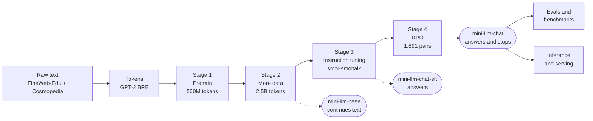

<div align="center">

# mini_llm

**A 124M-parameter language model, from raw text to a chat model you can serve.**<br>
Built in the open, one day at a time. Every stage is a script you can read, every number has a script behind it.


[**Start at Day 0**](days/day_00_setup/) · [The days](#the-days) · [What it can do](#what-it-can-and-cannot-do) · [The plan](docs/PLAN.md) · [About](#about)

</div>

---

```text
You:    What is the water cycle?
Model:  The water cycle, also known as the hydrological cycle, is the continuous process by which water circulates
        between the Earth's oceans, atmosphere, and land. It involves the movement of water on, above, and below the
        surface of the Earth ...
        [93 tokens · first token 365 ms · 69 tokens/s on an Apple M5]
```

That answer comes from a model small enough to train on a rented GPU and run on a laptop. This repo
shows how it was made, how it is measured and how it is served, in the order you would learn it.

## The pipeline



| Stage | Day | Data | Hardware | What changed |
|---|---|---|---|---|
| 1. Pretrain | [3](days/day_03_pretraining/) | 500M tokens of Mini FineWeb-Edu + Cosmopedia | Colab L4, 4 h 20 min | held-out web text loss 3.549 |
| 2. Continued pretrain | [4](days/day_04_more_data/) | 2.5B tokens | L4, then A100 | 3.296, past OpenAI GPT-2 small's 3.401 |
| 3. Instruction tuning | [5](days/day_05_instruction_tuning/) | smol-smoltalk conversations | A100, 19 min | it answers: held-out answer loss 2.316 → 1.390 |
| 4. Preference tuning (DPO) | [6](days/day_06_preference_tuning/) | 1,891 answer pairs | Mac, 19 min | it loops less: repetition on unseen questions 16.1% → 12.9% |

## Where do you want to start?

<details>
<summary><b>I want to run the model</b></summary>

<br>

```bash
git clone https://github.com/a-ramakrishnan/mini_llm.git
cd mini_llm
pip install -r requirements.txt
python3 scripts/link_weights.py ../tinystories-ARM-model/models    # until the weights are on the Hugging Face Hub
python3 scripts/chat.py "What is the water cycle?"
python3 scripts/chat.py --complete "The water cycle is the process by which"
python3 scripts/chat.py                                            # a conversation
```

The weights are not public yet: they go on the Hugging Face Hub on Day 20. Until then they come from a local
[tinystories-ARM-model](https://github.com/a-ramakrishnan/tinystories-ARM-model) library.
[Day 0](days/day_00_setup/) has the details.

</details>

<details>
<summary><b>I want to understand the model</b></summary>

<br>

[Day 1](days/day_01_the_model/) pushes one sentence through the model with every operation written out, and counts
where the 123,552,768 parameters are.

```bash
python3 days/day_01_the_model/forward_by_hand.py "The capital of France is"
python3 days/day_01_the_model/parameters.py
```

```text
most likely next tokens after "The capital of France is":
   40.8%  ' Paris'
    5.8%  ' the'
    1.8%  ' Rome'
```

| Part | Parameters | Share |
|---|---|---|
| Token embeddings (also the output layer) | 38,597,376 | 31.2% |
| 12 transformer blocks | 84,954,624 | 68.8% |
| Positions (RoPE) | 0 | 0% |

GPT-2 small's shape (12 layers × 768, 12 heads) with four changes: RoPE positions, SwiGLU feed-forward layers,
QK-norm, and no biases. The context is 512 tokens.

</details>

<details>
<summary><b>I want to train one myself</b></summary>

<br>

Training runs on Google Colab. Each training day has a notebook; runs are saved to your Google Drive, and each day
continues from the one before. The `mini` preset trains a 29.9M model so you can go through all four stages
without many GPU-hours.

| Day | Stage | Notebook |
|---|---|---|
| 3 | Pretrain | [](https://colab.research.google.com/github/a-ramakrishnan/mini_llm/blob/main/days/day_03_pretraining/day_03_pretraining.ipynb) |
| 4 | Continue on more data | [](https://colab.research.google.com/github/a-ramakrishnan/mini_llm/blob/main/days/day_04_more_data/day_04_more_data.ipynb) |
| 5 | Instruction tuning | [](https://colab.research.google.com/github/a-ramakrishnan/mini_llm/blob/main/days/day_05_instruction_tuning/day_05_instruction_tuning.ipynb) |
| 6 | Preference tuning (DPO) | [](https://colab.research.google.com/github/a-ramakrishnan/mini_llm/blob/main/days/day_06_preference_tuning/day_06_preference_tuning.ipynb) |

The scripts behind the notebooks were tested locally with small runs. The notebooks themselves have not been run on
Colab yet; the first run is the test.

</details>

<details>
<summary><b>I want to see how it is measured</b></summary>

<br>

[Day 7](days/day_07_evals/) runs the same five tests on every checkpoint and keeps every answer the model gave.

```bash
python3 days/day_07_evals/surprise.py        # what a loss of 3.3 means, token by token
python3 scripts/eval.py mini-llm-chat
python3 scripts/eval.py --report
```

The held-out text and the question sets are files in the repo, so you get the same numbers without downloading nine
datasets. Results are in [`results/`](results/).

</details>

<details>
<summary><b>I am here for inference and serving</b></summary>

<br>

That is Days 9 to 18, and it is where this repo aims to go furthest: the generation loop by hand, sampling, a
measuring harness (time to first token, latency percentiles, throughput), speed-ups, quantization, an
OpenAI-compatible server, a batching engine, load tests, constrained decoding and other runtimes. Each idea is
built, measured on the same model, and checked for the same output before any timing is quoted.

These days are planned, not built. [The plan](docs/PLAN.md#inference-days-9-to-18) has each one in full.

</details>

<details>
<summary><b>I want to fine-tune it on my own data</b></summary>

<br>

Day 19 adds ready-made [Axolotl](https://github.com/axolotl-ai-cloud/axolotl) configs: LoRA from a YAML file, with
a chat template that gives the same loss mask as Day 5. Planned, not built: it needs the `transformers` export
from Day 18 first.

</details>

## The days

One thing to do each day, a folder with a README and code you run, and a check that says the day is done.

| Day | Do this | Status |
|---|---|---|
| 0 | [Set up, get the weights, make the model write](days/day_00_setup/) | ✅ |
| 1 | [Read the model: every layer, every parameter, one forward pass by hand](days/day_01_the_model/) | ✅ |
| 2 | [Turn text into training batches: datasets, mixing, tokens, windows](days/day_02_data_and_tokens/) | ✅ |
| 3 | [Pretrain: the training loop, and a small model trained on Colab](days/day_03_pretraining/) | ✅ |
| 4 | [Scale the data five times: resume, re-warm, keep the held-out set held out](days/day_04_more_data/) | ✅ |
| 5 | [Instruction tuning: a chat format, a loss mask, a model that answers](days/day_05_instruction_tuning/) | ✅ |
| 6 | [Preference tuning: DPO against repetition](days/day_06_preference_tuning/) | ✅ |
| 7 | [Evals: held-out loss, generation quality, chat quality](days/day_07_evals/) | ✅ |
| 8 | Benchmarks: five standard tasks, reference models, the report | Planned |
| 9 | Inference by hand: prefill, decode, the KV cache | Planned |
| 10 | Sampling: temperature, top-k, top-p, penalties, search, stopping | Planned |
| 11 | Measure it: time to first token, latency, throughput, memory, and where the time goes | Planned |
| 12 | Faster: precision, compilation, batching, speculative decoding | Planned |
| 13 | Smaller: quantization, and what each bit costs in quality | Planned |
| 14 | A server: an OpenAI-compatible API, streaming, request state, a scheduler | Planned |
| 15 | A serving engine: continuous batching, KV-cache memory, prefix caching | Planned |
| 16 | Load tests: latency percentiles and throughput as traffic rises | Planned |
| 17 | Structured output: constrained decoding that cannot produce invalid JSON | Planned |
| 18 | Other runtimes: transformers, ONNX Runtime, MLX | Planned |
| 19 | Fine-tune it with Axolotl: LoRA from a YAML file | Planned |
| 20 | Ship: the front end, the weights on Hugging Face, the write-up | Planned |

## What it can and cannot do

It is a 124M model trained on 2.5B tokens. It writes fluent English, answers simple questions in the right shape,
and gets a lot wrong. The numbers below were measured with this repo's code unless a row says otherwise.

<details>
<summary><b>Against OpenAI's GPT-2 small, the same size</b></summary>

<br>

| | GPT-2 small (124M) | mini-llm-base | mini-llm-chat |
|---|---|---|---|
| Held-out educational web text (loss, lower is better) | 3.401 | **3.296** | 4.274 |
| HellaSwag | 31.1 | **32.3** | 30.1 |
| ARC-Easy | 43.8 | **46.8** | 42.0 |
| PIQA | **62.9** | 62.4 | 59.0 |
| Winogrande | **51.6** | 49.9 | 47.9 |
| LAMBADA | **32.6** | 20.3 | 12.9 |
| Average of the five | **44.4** | 42.3 | 38.4 |

The benchmark rows and GPT-2's loss were measured in the source project; Day 8 reproduces them here. The base model
beats GPT-2 small on the kind of text it was trained on and on two of five benchmarks, and is well behind on
LAMBADA. Chat tuning costs about four points.

</details>

<details>
<summary><b>What each training stage bought</b></summary>

<br>

| | Base | Instruction-tuned | After DPO |
|---|---|---|---|
| Held-out web text (loss) | **3.296** | 4.264 | 4.274 |
| Greedy answers to 100 unseen questions: repeated 4-token runs | not run yet | 16.1% | **12.9%** |
| Answers that end by themselves | not run yet | 73% | **78%** |
| Instructions followed, of 30 checked by code | 6 | **12** | 8 |
| Easy facts, of 40 | 11 | 19 | **20** |

On a different question set, the base model repeats 62.9% of its 4-token runs and ends 4% of its answers: it does
not answer questions, it continues them. Instruction tuning fixes that and costs a nat of loss on plain text.

</details>

<details>
<summary><b>Where it fails</b></summary>

<br>

```text
You:    Why is the sky blue?
Model:  The sky appears blue because of the presence of chlorophyll, a green pigment found in the ...

You:    What is the capital of Egypt?
Model:  The capital of Egypt is New York City, which is located in the state of New York City. ...

You:    What is 7 plus 5?
Model:  To find the sum of 7 plus 5, we can start by adding the numbers 7 and 5 together. This gives us
        7 + 5 = 11. ...

You:    Answer in one word: what colour is grass?
Model:  grass is a type of grass that belongs to the family of grasses, specifically the grasses family. ...

You:    Answer with only 'yes' or 'no': is the sun a star?
Model:  No, the sun is not a star.
```

- **Fluency is not knowledge.** Every wrong answer is a well-formed sentence.
- **It does not follow constraints.** No checkpoint obeys "one word", "yes or no" or "digits only".
- **It mostly cannot do arithmetic**: 3 of 8 easy sums.
- **Its context is 512 tokens**, and it is English only.

</details>

<details>
<summary><b>A result that did not survive checking</b></summary>

<br>

DPO was first reported as cutting repetition from 12.4% to 6.5%. Day 7 reproduces that number exactly, and then
shows that 84 of the 100 test questions had been DPO training pairs. On questions no training stage has seen, the
effect is 16.1% → 12.9%: real, and about half the size.

| Question set | Who had seen the questions | Repetition | Answers that end |
|---|---|---|---|
| First reported | instruction tuning, and DPO for 84 of 100 | 12.4% → 6.5% | 70% → 86% |
| The 100 DPO held out | instruction tuning | 15.0% → 10.4% | 69% → 81% |
| From the test split | nobody | **16.1% → 12.9%** | **73% → 78%** |

[Day 7](days/day_07_evals/#how-held-out-is-held-out) has the whole story.

</details>

## How the repo is laid out

```text
days/         one folder per day: a README and the code you run
mini_llm/     the Python package the days use
  model/        the GPT, its config, parameter counts
  dataset/      download, mix, tokenize, batch
  trainer/      pretrain, stage 2, instruction tuning, DPO
  evals/        held-out loss, generation, chat quality, instructions, facts
  inference/    sampling and streamed generation with a KV cache
scripts/      one entry point per job: chat, eval, prepare_data, train_*
results/      measurements as JSON, read by the READMEs
tests/        fast tests that need no weights and no GPU
docs/         the plan
```

```bash
python3 -m pytest        # the tests that need the real weights are skipped when they are not there
```

## About

**mini_llm** is a learning project by [a-ramakrishnan](https://github.com/a-ramakrishnan). The model was built in
[tinystories-ARM-model](https://github.com/a-ramakrishnan/tinystories-ARM-model), a lab where 57 models were
trained and compared on a Mac and on Colab. This repo takes the best one and lays it out for someone who wants to
follow one model end to end.

It borrows two ideas:

- From [MiniMind](https://github.com/jingyaogong/minimind): one small model, one pipeline, every stage in plain
  PyTorch.
- From [Inference Engineering From First Principles](https://github.com/navaneethkrishnansuresh/Inference-Engineering):
  the day-by-day shape, and treating inference as something to build and measure.

What it tries to add:

- **Inference as half the project.** Ten of the twenty-one days: the loop, measurement, speed, quantization, a
  server, a batching engine, load tests.
- **Numbers you can check.** Results are files written by scripts in this repo, with the model's answers kept.
- **The failures, stated.** Including one of its own results that turned out to be too good.

It is not a production system and not a claim of a new method. It is under construction: Days 0 to 7 are written,
the rest are planned in [docs/PLAN.md](docs/PLAN.md).

## Credits

- The model and data loading are adapted from Andrej Karpathy's [nanoGPT](https://github.com/karpathy/nanoGPT).
- Data: [Mini FineWeb-Edu](https://huggingface.co/datasets/BaoMinhTran/mini-fineweb-edu),
  [Cosmopedia](https://huggingface.co/datasets/HuggingFaceTB/cosmopedia) and
  [smol-smoltalk](https://huggingface.co/datasets/HuggingFaceTB/smol-smoltalk).

## License

[MIT](LICENSE)
